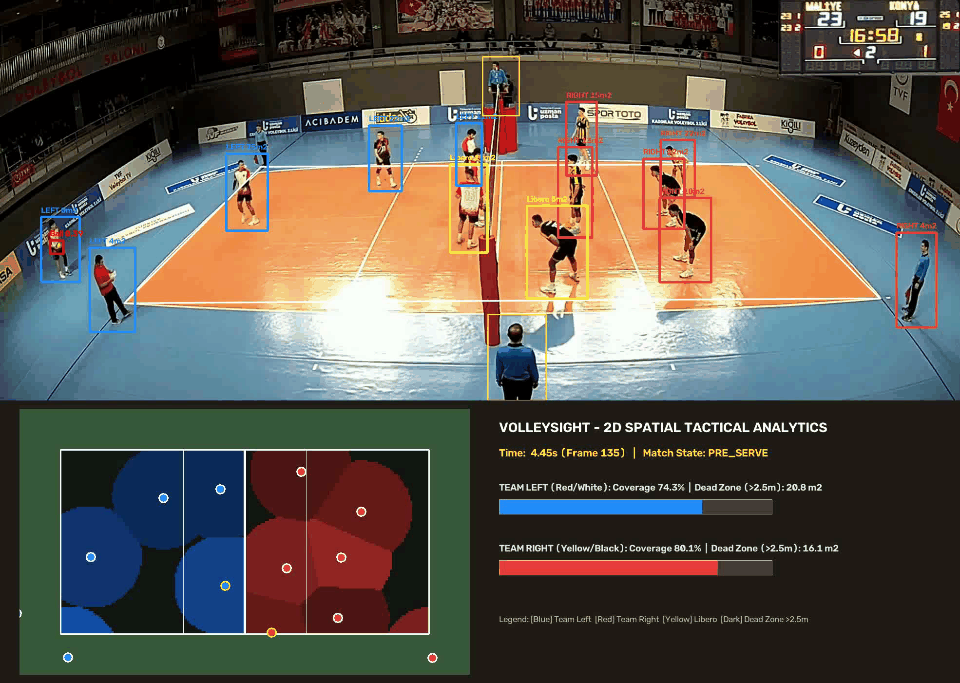
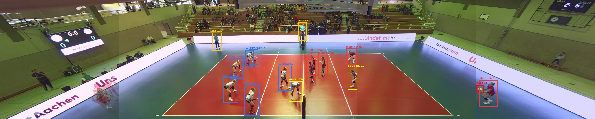
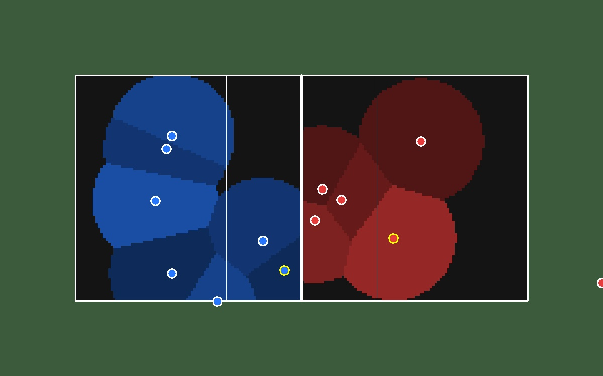

# VolleySight — Panoramic Sports Vision & 2D Spatial Tactical Analytics

**VolleySight** is an end-to-end Computer Vision system that reconstructs full-court `3840 × 768` volleyball panoramas from multi-tile arena cameras, detects players, referees, and small fast-moving balls (`~33×34 px`), separates teams and Liberos without manual team annotations, and projects player footpoints onto a `18m × 9m` 2D tactical radar with real-time **Voronoi court coverage** and **defensive dead-zone analysis**.





---

## 1. Key Engineering Highlights

1. **Leakage-Free Video-Grouped Evaluation (`src/data_split.py`):**
   - Audits `1,051` horizontal tiles (`768 × 768`) across `11` matches (`309` timestamps, `5,190` boxes).
   - Proves empirically that naive random image splitting leaks static arena backgrounds across `5.0s` intervals, inflating validation `mAP@50` by **`+5.0%`** (`0.894 → 0.944`) and `mAP@50-95` by **`+13.9%`** (`0.469 → 0.608`).
2. **Panoramic Canvas Reconstruction & Cross-Tile Seam Merging (`src/panorama.py`):**
   - Recovers missing unannotated outer tiles (`_0`, `_4`) via per-video **Temporal Median Background Modeling** (`3840 × 768`).
   - Fuses **66 boundary-split objects** across tile seams (`x ∈ {768, 1536, 2304, 3072}`) using 1D vertical IoU (`IoU_y >= 0.30, delta_x <= 12 px`) + global duplicate suppression, boosting panoramic precision from **`81.8%` to `89.1%` (`+7.3%`)** and cutting false positives by **`46.0%`** (`113 → 61`).
3. **Small-Object (`Ball`) Detection (`src/detector.py`):**
   - Fine-tunes `YOLO11s` at native `768 × 768` resolution with Copy-Paste (`0.3`) and Mosaic (`1.0`) augmentation.
   - Achieves **`0.927 mAP@50`** on held-out test video (`Player`: `0.989 AP@50`, `Referee`: `0.977 AP@50`, `Ball`: `0.817 AP@50` standard / **`0.863 AP@50`** with `1152px` high-res inference).
4. **Annotation-Free Tactical Intelligence (`src/tactics.py`):**
   - Projects player ground-contact points (`foot_pano`) via 4-point planar **Homography** onto standard FIVB `18.0m × 9.0m` court coordinates.
   - Combines court-half geometry with **CIE-Lab torso K-Means clustering** to identify `TEAM_LEFT`, `TEAM_RIGHT`, and contrasting-jersey `Libero` players (`97.2%` valid formation separation on test frames).
   - Computes `0.1m`-resolution (`180 × 90`) bounded **Voronoi tessellations** per half-court (`81.0 m²`), quantifying per-player controlled area (`m²`), team coverage `%`, and unprotected **Defensive Dead Zones** (`> 2.5m` from any defender).

---

## 2. Quantitative Results & Ablations

Full tables available in [`artifacts/eval/ablation_results.md`](artifacts/eval/ablation_results.md).

### 2.1 Scene Leakage Benchmark (Random vs Video-Grouped Split)
| Split Strategy | Val Precision | Val Recall | Val mAP@50 | Val mAP@50-95 | Test mAP@50 |
| :--- | :---: | :---: | :---: | :---: | :---: |
| Naive Random Split (Leaked Arenas) | 0.914 | 0.918 | 0.944 | 0.608 | 0.970 (leaked) |
| **Video-Grouped Split (Ours)** | **0.888** | **0.866** | **0.894** | **0.469** | **0.927** |

### 2.2 Cross-Tile Seam Fusion & Small-Ball Inference (`group_split` Test Set)
| Pipeline Variant | Precision | Recall | False Positives | `Ball` AP@50 | Overall mAP@50 |
| :--- | :---: | :---: | :---: | :---: | :---: |
| Raw Per-Tile Predictions (`imgsz=768`) | 0.818 | 0.962 | 113 | 0.817 | 0.927 |
| **+ Seam Merger & Global NMS** | **0.891 (`+7.3%`)** | **0.945** | **61 (`-46.0%`)** | 0.817 | 0.927 |
| **+ TTA (`augment=True`)** | — | — | — | 0.842 (`+2.5%`) | **0.935** |
| **+ High-Res Upscale (`imgsz=1152`)** | — | — | — | **0.863 (`+4.6%`)** | 0.931 |

---

## 3. Quickstart & Reproduction

```bash
# 1. Generate leakage-free video-grouped splits & dataset audit JSON
python3 src/data_split.py

# 2. Reconstruct per-video temporal median backgrounds & verify seam merging
python3 src/panorama.py

# 3. Evaluate trained YOLO11s models & regenerate ablation tables
python3 src/detector.py eval

# 4. Run 2D Homography, CIE-Lab Team/Libero clustering & Voronoi self-check
python3 src/tactics.py

# 5. Run unit & integration test suite
python3 tests/test_pipeline.py

# 6. Launch interactive 3-panel Streamlit dashboard
streamlit run app.py
```

---

## 4. Repository Structure

```text
Volleyball/
├── volleyball_data/              # [READ-ONLY] 1,051 tiles (768x768) + YOLO labels + classes.txt
├── artifacts/
│   ├── splits/                   # Symlinked group_split & random_split datasets
│   ├── backgrounds/              # Temporal median background tiles per (video_id, tile_idx)
│   ├── homography.json           # Per-video 4-point court calibration -> 18m x 9m plane
│   ├── runs/                     # Trained YOLO11s weights (group_split & random_split)
│   └── eval/                     # Ablation tables, panorama before/after seam merge, radar visuals
├── src/
│   ├── data_split.py             # Dataset audit & video-grouped split generator
│   ├── panorama.py               # Temporal median background stitcher & cross-tile seam merger
│   ├── detector.py               # YOLO11s training, multi-scale inference & seam ablation
│   └── tactics.py                # CIE-Lab K-Means team/libero clustering, 2D homography & Voronoi
├── tests/
│   └── test_pipeline.py          # Automated verification suite (6/6 passing)
├── colab/
│   └── train_colab.ipynb         # Turnkey A100 Colab training notebook
├── app.py                        # Interactive Streamlit dashboard (Panorama + 2D Radar + JSON)
├── CONTEXT.md                    # Mathematical & empirical specification
├── PROJECT_MAP.md                # Architecture & data contracts
├── AGENTS.md                     # Engineering invariants & verification gates
├── LEARNING_GUIDE.md             # Step-by-step self-study companion guide
└── plan.md                       # Completed implementation roadmap
```

---

## 5. Known Limitations

1. **Arena Overlap Across Video IDs:** While all `11` `video_id` prefixes are separated across Train/Val/Test, test video `mak0QV2pk` and train video `maJM7QoN7` were recorded in the same arena (`NetAachen`). True cross-venue evaluation is best reflected by the **Validation set (`0.894 mAP@50`)**, where `majXaA68z` and `maNen4zOD` come from completely distinct halls.
2. **Manual 4-Point Homography Calibration:** Court corners in `artifacts/homography.json` were calibrated manually on stitched background grids for the 9 full-court videos (`maoB9V01v` and `maOeB7zdz` are excluded from 2D projection due to having only 1–3 timestamps).
3. **2D Ball Ground Projection:** Projecting an airborne ball through a ground-plane homography maps its perspective ray onto the floor rather than its true 3D `(X, Y, Z)` coordinates.
